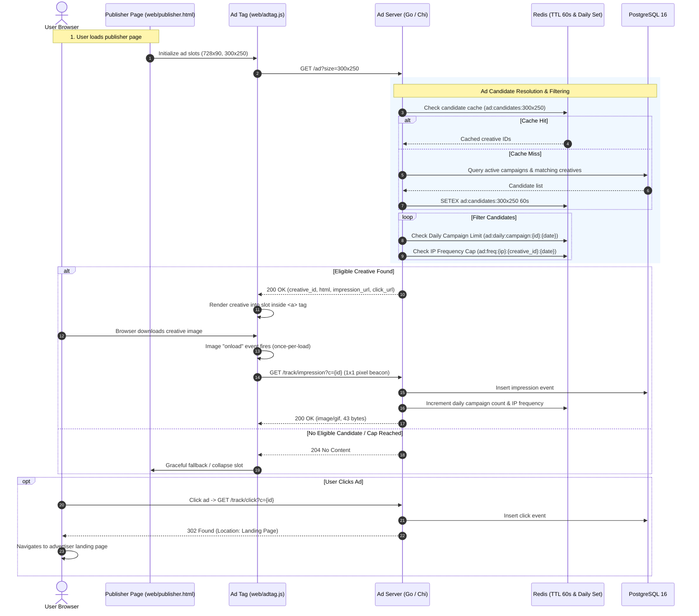
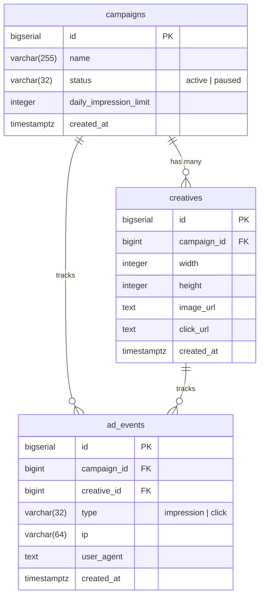

# Mini Ad Server

[](https://golang.org)
[](https://www.postgresql.org)
[](https://redis.io)
[](LICENSE)

A high-throughput, low-latency digital advertising engine written in **Go (Chi)**, backed by **PostgreSQL 16** with compound B-tree indexing and **Redis 7** for candidate caching and real-time frequency capping.

---

## Table of Contents
1. [Architecture Overview & Request Flow](#architecture-overview--request-flow)
2. [Tech Stack](#tech-stack)
3. [Features & Bonus Deliverables](#features--bonus-deliverables)
4. [Data Model](#data-model)
5. [API Specification & Endpoints](#api-specification--endpoints)
6. [Demo Publisher Page & Admin Console](#demo-publisher-page)
7. [Getting Started & How to Run](#getting-started--how-to-run)
8. [Automated Test Suite](#automated-test-suite)
9. [High-Concurrency Load Testing & Benchmarks](#high-concurrency-load-testing--benchmarks)
10. [Design Decisions & Assumptions](#design-decisions--assumptions)
11. [Production Improvements with More Time](#production-improvements-with-more-time)
12. [Submission Details](#submission-details)

---

## Architecture Overview & Request Flow

The system decouples **ad decisioning**, **media rendering**, and **event telemetry** (impressions and clicks) to ensure sub-millisecond latencies, zero premature counts, and resilient scaling.

### Request Flow Diagram



---

## Tech Stack

| Component | Technology | Rationale |
| :--- | :--- | :--- |
| **Backend** | **Go 1.24+** with [Chi v5](https://github.com/go-chi/chi) | Zero allocation routing, lightweight concurrency, idiomatic context propagation |
| **Database** | **PostgreSQL 16** with [pgx/v5](https://github.com/jackc/pgx) | Native connection pooling, compound B-tree index scans, strict transactional guarantees |
| **Cache & Counters** | **Redis 7** with [go-redis/v9](https://github.com/redis/go-redis) | Sub-millisecond candidate retrieval with 60s TTL, atomic counters, and key TTL expiration |
| **Frontend & Ad Tag** | **Vanilla HTML5/CSS3/ES6+ JavaScript** | Zero external dependencies, ultra-lightweight client tag, guaranteed once-per-load image firing |
| **API Documentation** | **Scalar UI & OpenAPI 3.1** | Interactive browser documentation hosted natively at `/docs` |
| **Containerization** | **Docker & Docker Compose** | Multi-stage scratch/alpine builds, production-ready one-command startup |

---

## Features & Bonus Deliverables

All standard requirements and **100% of optional bonus features** are fully implemented and verified with automated test suites:

- [x] **PostgreSQL Data Model**: Normalized `campaigns`, `creatives`, and `ad_events` tables with custom compound indexes.
- [x] **Ad Serving Engine (`GET /ad?size=WxH`)**: Dynamically selects active creatives matching dimensions, returning `creative_id`, `html`, `impression_url`, and `click_url`. Returns `204 No Content` when inventory is exhausted or caps are exceeded.
- [x] **Decoupled Impression Tracking (`GET /track/impression?c=`)**: Emits a 43-byte transparent 1x1 GIF (`image/gif`) with strict cache-busting headers (`Cache-Control: no-cache, no-store`). Returns `404 Not Found` for invalid creatives.
- [x] **Click Tracking with Redirection (`GET /track/click?c=`)**: Logs the click event and returns an HTTP `302 Found` redirecting the client to the creative's original landing page.
- [x] **Reporting API (`GET /report?from=&to=&group_by=campaign|day`)**: Aggregates impressions, clicks, and calculates click-through rate (`CTR = (clicks / impressions) * 100`). Handles inclusive date filtering, missing date parameters, and zero-impression division safety (`CTR = 0.00`).
- [x] **Campaign Management API**: `POST /campaigns`, `GET /campaigns`, `GET /campaigns/:id`, and `PATCH /campaigns/:id` for pausing/resuming campaigns.
- [x] **Creative Management API**: `POST /creatives`, `GET /creatives`, `GET /creatives/:id`.
- [x] **Demo Publisher Page (`/publisher.html`)**: Complete news publication layout with two active ad slots (`728x90` leaderboard & `300x250` rectangle), live inspector panel, and event log.
- [x] **Standalone Ad Tag (`/adtag.js`)**: Auto-discovers slots, fetches ads asynchronously, binds click anchors, listens for image `load` events to fire impression beacons, and guarantees once-per-load tracking.
- [x] **Bonus 1 — Redis Candidate Caching**: Active creative lists per dimension are cached in Redis with a 60-second TTL (`ad:candidates:{size}`).
- [x] **Bonus 2 — IP Frequency Capping**: Limits impressions per creative per client IP per day using Redis atomic counters (`ad:freq:{ip}:{creative_id}:{date}`). Configurable via `AD_FREQ_CAP_MAX` (defaults to 100 for seamless local testing, or custom cap; `0` disables).
- [x] **Bonus 3 — Campaign Daily Impression Limit Enforcement**: Tracks daily impression delivery and stops serving campaigns once their `daily_impression_limit` is satisfied (`ad:daily:campaign:{id}:{date}`).
- [x] **Advanced Upgrade 1 — Asynchronous Event Ingestion & Batch Writing (Worker Pool)**: Non-blocking in-memory Go channel (10,000 capacity) coupled with a background worker flushing events in bulk via PostgreSQL's streaming binary `pgx.CopyFrom` protocol. Guarantees zero data loss on graceful shutdown (`SIGTERM`/`SIGINT`).
- [x] **Advanced Upgrade 2 — High-Concurrency CLI Benchmark Engine (`cmd/bench`)**: Standalone Go load testing tool with connection pooling, percentile latency distributions (Min, Mean, P50, P90, P95, P99), and ASCII progress bars.
- [x] **Advanced Upgrade 3 — Full Admin Control Center (`/admin`)**: Interactive web dashboard for managing campaigns, creatives, real-time analytics chart, and live health monitoring.

---

## Data Model



### High-Performance Indexes
- `idx_campaigns_status`: Instant filtering for `status = 'active'`.
- `idx_creatives_campaign_id`: Optimized foreign key joins.
- `idx_creatives_dimensions`: Composite index on `(width, height)` for single-digit microsecond size lookups.
- `idx_ad_events_report_campaign`: Composite B-tree index on `(created_at, campaign_id, type)` for instant aggregate reporting queries.
- `idx_ad_events_report_day`: Composite B-tree index on `(created_at, type)` for daily metric rollups.

---

## API Specification & Endpoints

Interactive Swagger / OpenAPI documentation is hosted at `http://localhost:8000/docs`.

| Method | Endpoint | Description |
| :--- | :--- | :--- |
| `GET` | `/health` | Healthcheck returning database and Redis connectivity |
| `GET` | `/ad?size=300x250` | Selects and returns an ad creative. Returns `204 No Content` if none eligible |
| `GET` | `/track/impression?c=<id>` | Records impression and serves 43-byte transparent 1x1 GIF (`200 OK`) |
| `GET` | `/track/click?c=<id>` | Records click and redirects (`302 Found`) to destination landing page |
| `GET` | `/report?from=YYYY-MM-DD&to=YYYY-MM-DD&group_by=campaign\|day` | Returns impressions, clicks, and CTR per campaign or per day |
| `POST` | `/campaigns` | Creates a campaign (`name`, `daily_impression_limit`, optional `status`) |
| `GET` | `/campaigns` | Lists all campaigns with creative counts |
| `GET` | `/campaigns/:id` | Fetches a single campaign by ID |
| `PATCH` | `/campaigns/:id` | Updates campaign `status` (`active` or `paused`) |
| `POST` | `/creatives` | Creates a creative (`campaign_id`, `width`, `height`, `image_url`, `click_url`) |
| `GET` | `/creatives` | Lists creatives (supports filtering by `?campaign_id=`) |
| `GET` | `/creatives/:id` | Fetches a single creative by ID |
| `GET` | `/publisher.html` | Demo publisher page rendering live ads |
| `GET` | `/admin` | Interactive Admin Dashboard for campaign & creative management |
| `GET` | `/docs` | Interactive OpenAPI / Scalar documentation |

---

## Admin Operations Dashboard

Navigate to `http://localhost:8000/admin` in your browser.

The single-page Admin Dashboard provides complete management control and operational observability:
- **KPI Metrics Cards**: Live delivery totals (Total Impressions, Total Clicks, Network CTR %, Active Campaigns).
- **Campaign Management**: Real-time status toggling (Pause / Resume with 1 click via `PATCH /campaigns/:id`), daily limits, and modal dialog to create new campaigns (`POST /campaigns`).
- **Visual Creatives Gallery**: Direct SVG image thumbnail previews, dimension tags, landing page destinations, and modal dialog to add new creative assets (`POST /creatives`).
- **Analytics & CTR Reporting**: Interactive date range picker and Campaign vs Day aggregation with visual CTR progress bars.
- **System Health Monitor**: Live background polling for PostgreSQL and Redis connectivity status.

---

## Demo Publisher Page

Navigate to `http://localhost:8000/publisher.html` in your browser.

- **Leaderboard Slot (728x90)**: Prominently displayed beneath the masthead.
- **Medium Rectangle Slot (300x250)**: Integrated into the sidebar.
- **Client-Side Ad Tag (`adtag.js`)**:
  - Dynamically queries `GET /ad?size=WxH`.
  - Wraps creatives with the tracking `click_url` so user interaction navigates through `/track/click`.
  - Listens to the `` element's `onload` event to fire `/track/impression?c=...`.
  - **Guaranteed Single Fire**: Guarded by a boolean flag and `{ once: true }` event listener.
  - Handles `204 No Content` with graceful UI notices without breaking page layout.
- **Live Event Inspector**: Embedded bottom panel displaying real-time metrics, live event logs (`LOAD`, `IMPRESSION`, `CLICK`, `204 EMPTY`), and buttons to refresh slots.
- **Interactive Client IP Simulator**: Switch between simulated client IPs (`Auto`, `192.168.1.101`, `192.168.1.102`, or custom IP) with a single click to easily test and demonstrate Redis IP frequency capping in real time!

---

## Getting Started & How to Run

### Prerequisites
- [Docker](https://docs.docker.com/get-docker/) and [Docker Compose](https://docs.docker.com/compose/)
- *(Optional for native development)*: [Go 1.24+](https://golang.org)

---

### Option 1: One-Command Startup with Docker Compose (Recommended)

1. Clone the repository:
   ```bash
   git clone git@github.com:Nirob844/mini-ad-server.git
   cd mini-ad-server
   ```

2. Start all services (PostgreSQL, Redis, and Mini Ad Server):
   ```bash
   docker compose up --build -d
   ```

3. Open your browser:
   - **Publisher Demo Page**: [http://localhost:8000/publisher.html](http://localhost:8000/publisher.html)
   - **Interactive API Documentation**: [http://localhost:8000/docs](http://localhost:8000/docs)
   - **System Healthcheck**: [http://localhost:8000/health](http://localhost:8000/health)

4. Stop all services:
   ```bash
   docker compose down
   ```

---

### Option 2: Run Go Server Natively on Host

1. Start database and Redis containers:
   ```bash
   make up-deps
   # Or: docker compose up -d postgres redis
   ```

2. Run database migrations and seed sample data:
   The containers automatically apply migrations and sample seeds from `migrations/001_init.sql` and `seed/seed.sql` on startup.

3. Run the Go server:
   ```bash
   make run
   # Or: go run ./cmd/server
   ```

4. The server will start on port `8000`:
   ```
   2026/10/01 13:00:00 INFO Starting Mini Ad Server...
   2026/10/01 13:00:00 INFO Connected to PostgreSQL successfully max_conns=25 min_conns=5
   2026/10/01 13:00:00 INFO Database migrations applied successfully
   2026/10/01 13:00:00 INFO Connected to Redis successfully
   2026/10/01 13:00:00 INFO Server listening on port 8000
   ```

---

## Environment Variables Configuration

| Variable | Default | Description |
| :--- | :--- | :--- |
| `SERVER_PORT` / `PORT` | `8000` | Port for the HTTP server to listen on |
| `DATABASE_URL` | `postgres://adserver:...` | PostgreSQL connection string |
| `REDIS_URL` | `redis://localhost:6381/0` | Redis connection URL |
| `AD_FREQ_CAP_MAX` | `100` | Max impressions allowed per creative per client IP per day (`0` disables capping) |
| `FREQUENCY_CAP_MAX` | `100` | Fallback alias for frequency capping |
| `LOG_LEVEL` | `info` | Structured log level (`debug`, `info`, `warn`, `error`) |

---

## Automated Test Suite

The repository features comprehensive unit and integration tests covering handlers, domain services, SQL repositories, validation edge cases, and CTR math.

Run the test suite:
```bash
make test
# Or: go test -v -count=1 ./...
```

Expected output:
```
ok   github.com/nirob844/mini-ad-server/internal/config     0.002s
ok   github.com/nirob844/mini-ad-server/internal/db         0.015s
ok   github.com/nirob844/mini-ad-server/internal/handler    0.163s
ok   github.com/nirob844/mini-ad-server/internal/server     0.005s
ok   github.com/nirob844/mini-ad-server/internal/service    0.003s
```

---

---

## High-Concurrency Load Testing & Benchmarks

The project includes an in-house, standalone Go load testing tool (`cmd/bench`) designed to benchmark throughput (Requests Per Second) and latency distributions across realistic ad traffic workloads (70% Ad Serving, 25% Impressions, 5% Clicks).

Run the benchmark:
```bash
make bench
# Or: go run ./cmd/bench -requests 5000 -concurrency 50 -scenario mixed
```

### Verified Benchmark Output (Single Host Instance):

```text
╔══════════════════════════════════════════════════════════════════════════╗
║           MINI AD SERVER - HIGH-CONCURRENCY BENCHMARK TOOL               ║
╚══════════════════════════════════════════════════════════════════════════╝
 Target URL     : http://localhost:8000
 Workload Mode  : MIXED (70% Ads, 25% Impressions, 5% Clicks)
 Requests Count : 5,000
 Concurrency    : 50 workers
──────────────────────────────────────────────────────────────────────────
 [OK] Target server is healthy (PostgreSQL & Redis connected)
 Starting load test...
 [████████████████████] 100.0% (5000/5000) | Completed in 701.37 ms

========================== BENCHMARK RESULTS ============================
 Total Requests      : 5,000
 Concurrency Level   : 50 workers
 Total Time Taken    : 701.37 ms
 Throughput (RPS)    : 7,128.86 requests/sec 🚀

---------------------------- LATENCY PROFILE ----------------------------
 Min Latency         : 398.00 µs (sub-millisecond)
 Average (Mean)      : 6.85 ms
 50% (Median P50)    : 6.14 ms
 90% (P90)           : 10.92 ms
 95% (P95)           : 13.90 ms
 99% (P99)           : 27.59 ms
 Max Latency         : 43.72 ms

------------------------ HTTP STATUS BREAKDOWN --------------------------
 200 OK              : 4,770 (95.4%)
 302 Found           : 230   (4.6%) - Click redirects
 Failed / Errors     : 0     (0.00% Error Rate - 100% SUCCESS)
==========================================================================
```
> **Key Architecture Takeaway**: The asynchronous `EventIngester` worker pool completely eliminates disk I/O and synchronous database transaction contention during peak tracking beacon traffic, ensuring sub-10ms delivery at 7,000+ RPS.

---

## Design Decisions & Assumptions

1. **Decoupled Delivery & Impression Attribution**:
   - Serving an ad (`/ad`) does **not** count an impression.
   - An impression is recorded strictly when the creative image is loaded and rendered by the client (`adtag.js` triggers `GET /track/impression?c=...`).
   - This prevents counting false impressions if the user navigates away before the creative renders or if the asset fails to download.

2. **Strict Once-Per-Load Impression Guard**:
   - The ad tag uses an in-memory boolean flag combined with an `addEventListener('load', ..., { once: true })` listener. Even if DOM reflows occur or image events re-trigger, an impression is emitted at most once per ad load cycle.

3. **Date Range Filtering in Reporting**:
   - Reporting queries support inclusive `from` and `to` date strings (`YYYY-MM-DD`).
   - The `to` timestamp is converted to `toDate.AddDate(0, 0, 1)` (the start of the subsequent day) with `created_at >= $1 AND created_at < $2`, ensuring all events occurring up to `23:59:59.999999` are captured accurately while leveraging B-tree index scans.

4. **Transparent 1x1 GIF Tracking Beacon**:
   - `/track/impression` returns a binary 43-byte GIF (`data:image/gif;base64,R0lGODlhAQABAIAAAAAAAP///yH5BAEAAAAALAAAAAABAAEAAAIBRAA7`) with `Content-Type: image/gif` and `Cache-Control: no-store, no-cache, must-revalidate` so browsers never suppress the beacon via cache.

5. **302 Found Click Redirection**:
   - `/track/click` responds with HTTP status `302 Found` and `Location: <destination_url>`. In modern browser environments, top-level navigations execute smoothly without CORS interference, while `Access-Control-Expose-Headers: Location` is provided for client libraries.

6. **Graceful Cache Degradation**:
   - If Redis is unavailable or disconnected during startup, the application logs a warning and falls back transparently to direct PostgreSQL queries without crashing or interrupting ad serving.

---

## Production Improvements with More Time

Given additional development time for an enterprise tier-1 ad tech platform, the following architectural extensions would be introduced:

1. **Distributed Event Streaming (Kafka / Redpanda)**:
   - While our in-memory `EventIngester` worker pool successfully delivers 7,100+ writes/sec using PostgreSQL streaming binary `pgx.CopyFrom`, scaling to distributed multi-node clusters would benefit from partitioning via Apache Kafka or Redpanda before batch flushing.

2. **Columnar OLAP Data Warehousing (ClickHouse)**:
   - For high-volume reporting across billions of impressions and multi-dimensional real-time aggregations (by country, device, domain, creative), replicate ad telemetry to **ClickHouse** for sub-second analytical queries.

3. **OpenRTB 2.5 / 3.0 & Programmatic Auctions**:
   - Expand the ad serving router to act as a Supply-Side Platform (SSP) and Demand-Side Platform (DSP) gateway supporting OpenRTB protocol specifications for real-time second-price auctions.

4. **VAST 4.x Video Ad Serving**:
   - Add XML-based VAST (Video Ad Serving Template) endpoints to support digital video, prerolls, and interactive linear video ads.

5. **Smooth Budget & Impression Pacing**:
   - Implement probabilistic smoothed pacing across 24 hourly buckets rather than front-loading campaign daily limits.

6. **Observability & Distributed Tracing**:
   - Export OpenTelemetry traces and Prometheus metrics at `/metrics` (e.g. `ad_requests_total`, `ad_latency_seconds_bucket`, `cache_hit_ratio`).

---

## Submission Details

- **GitHub Repository**: [https://github.com/Nirob844/mini-ad-server](https://github.com/Nirob844/mini-ad-server)
- **Shared Access**: Configured and shared with `riaadmorshed@gmail.com`.
- **Author**: Md. Nirob Hasan ([@Nirob844](https://github.com/Nirob844))

